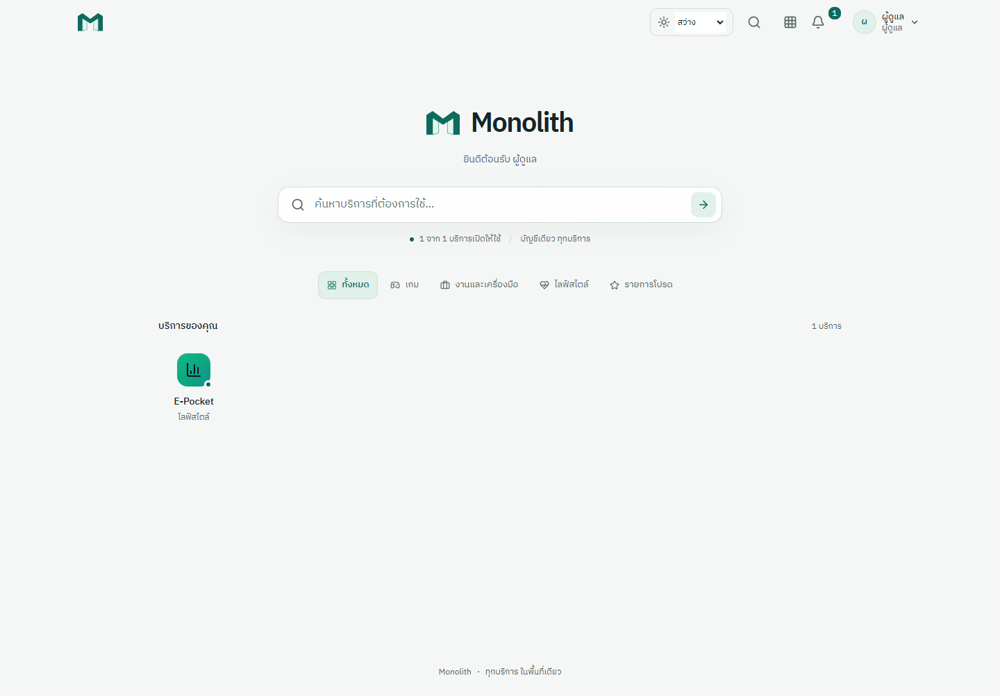
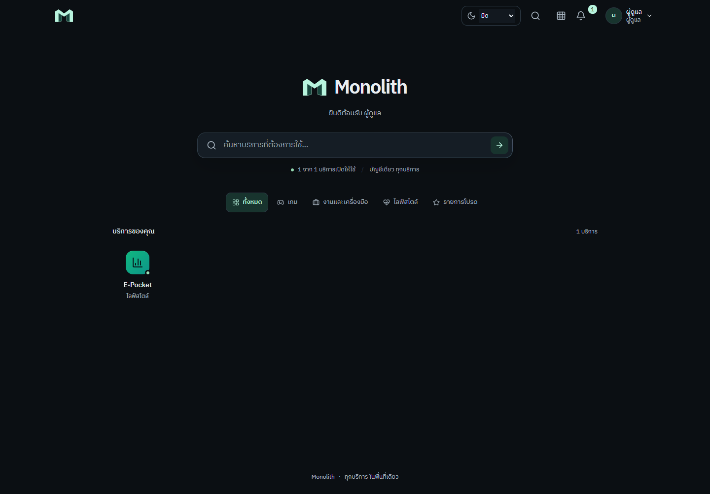
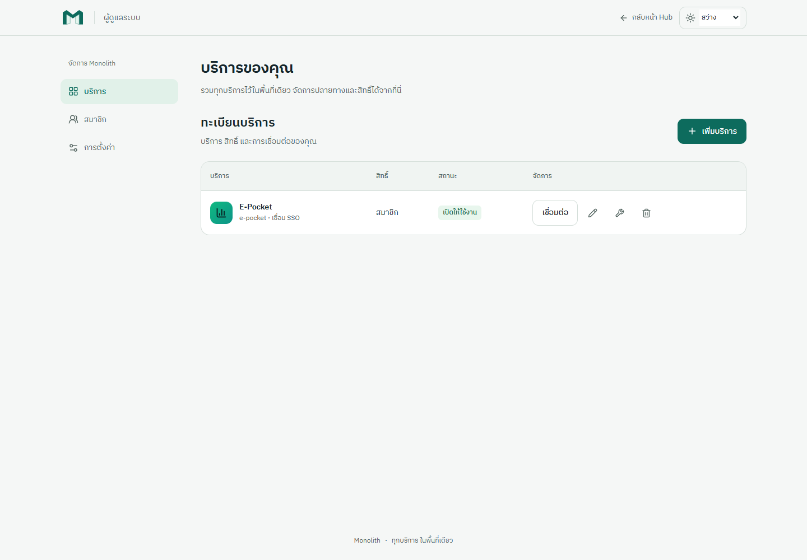
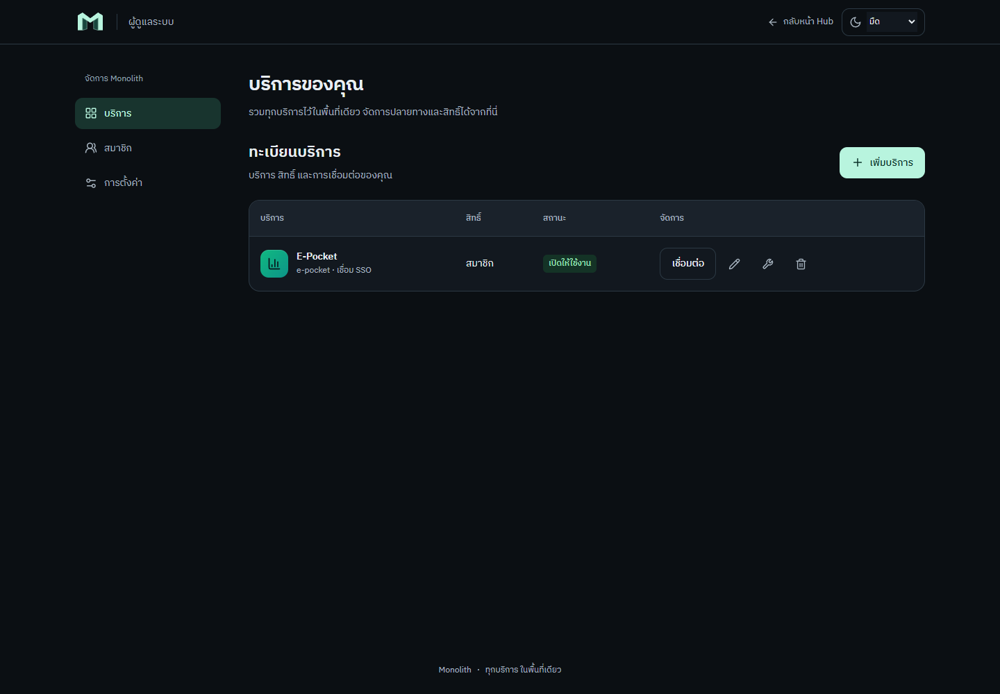

# Monolith Workspace

Monolith is a compact service launcher. The M mark and centered search are its focal point; ordinary content uses solid surfaces. Glass is reserved for search and floating menus. Services remain icon shortcuts, not generic dashboard cards.

## Tokens and typography

The semantic CSS variables in `globals.css` own background, surface, text, muted text, border, accent and status colors. Light uses #F5F7F6 / #FFFFFF / #0D6B5D; dark uses #0B0F13 / #12181F / #B8F4DE. Tailwind semantic colors reference these variables. Service icon palettes are user-selected identity colors and remain independent of the page theme.

IBM Plex Sans Thai 400/500/600 is self-hosted with its OFL license. Main copy is 14–16px and secondary copy is at least 12px. Inputs are 16px and primary touch targets are 44px. Launcher icons are 48px in 8/5/3 columns at desktop/tablet/phone widths.

## Interaction and state

The theme preference is system/light/dark, stored by next-themes at `monolith-theme`. The root uses class-based themes and suppresses hydration warnings only on html. Theme controls keep a fixed footprint before mounting.

A literal pre-paint script sets the initial class in the document head. The library's serialized bootstrap is rendered inert; OpenNext's Workers bundler adds function-name helpers that are unavailable inside the serialized script. Runtime theme selection and synchronization still use next-themes. The browser tests assert the saved theme before hydration on both runtimes.

Admin sections use `?section=services|members|settings`; account sections use `?section=profile|security|devices`. Unknown values fall back to services/profile. Existing endpoint contracts, role checks and database data are preserved.

Service creation keeps a draft through three steps: identity, destination/access, review. Only the final save writes data. Errors return to the relevant step. SSO onboarding shows the existing SDK env names, service identifier, one-time token and last-use metadata. It never claims a connection succeeded without a recorded call.

Native dialogs provide focus containment, Escape and focus restoration. Destructive actions use the shared confirmation provider; unsaved service drafts and uncopied tokens warn before dismissal. Email/password forms have independent password state. Verification/recovery fragments stay in component memory and are consumed only on explicit confirmation.

## Motion and access

The entry sequence uses transform/opacity for 280ms and settles within 440ms. Search/filter/focus changes do not replay it. Keyboard search opens immediately. Reduced motion removes movement; reduced transparency and increased contrast replace glass with solid surfaces. All asynchronous flows expose loading, success, error or retry states.

Validate both themes at 360/390/768/1440px, long Thai labels, no-results/empty states, theme persistence/system changes, keyboard dialog behavior, recovery/verification in development Strict Mode, and existing account/SSO/notification tests on Node and Workers. Use isolated fixtures and delete them after validation.

## Review screenshots

The screenshots use a temporary administrator in an isolated database and a copy of the existing service's display metadata. Production account/session/credential data is not copied.

| Surface | Light                                                 | Dark                                                |
| ------- | ----------------------------------------------------- | --------------------------------------------------- |
| Hub     |      |      |
| Admin   |  |  |
